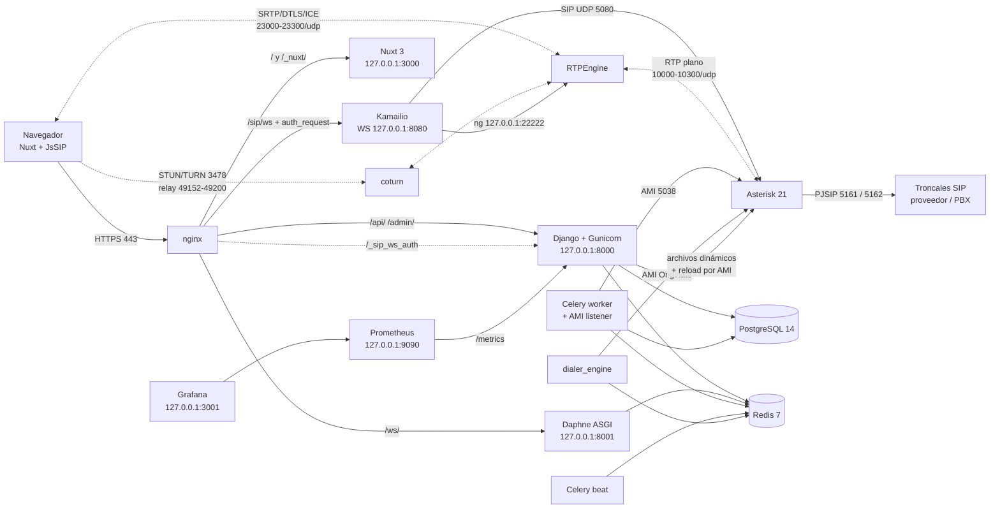
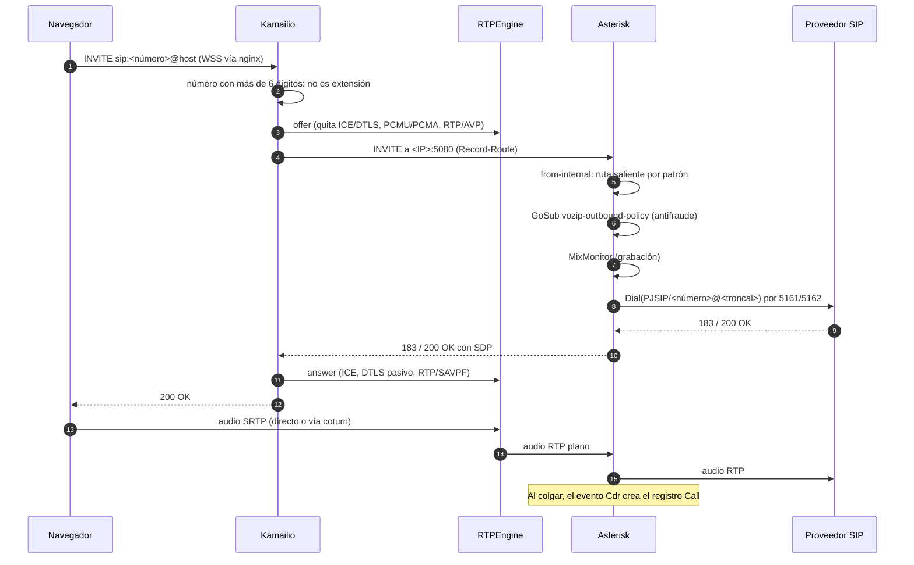
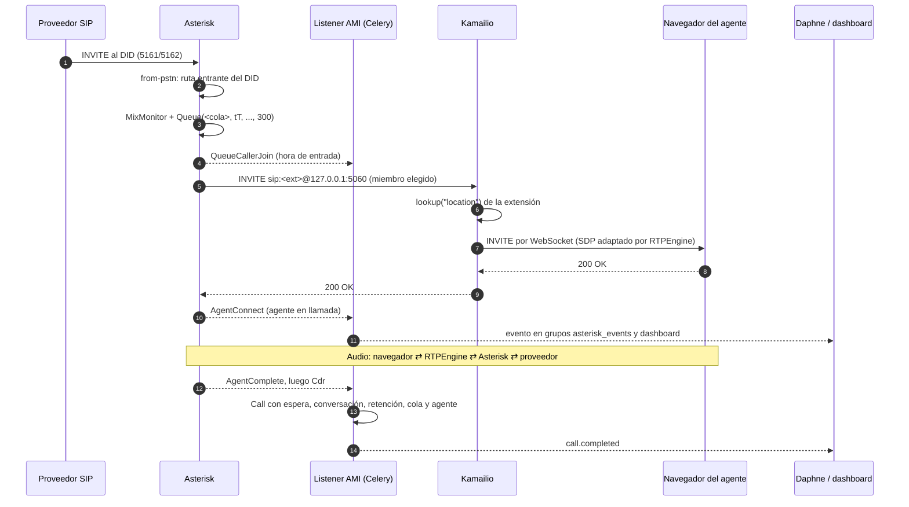

# Arquitectura de VozipOmni

Este documento describe los componentes de VozipOmni en producción, qué responsabilidad tiene cada uno y cómo fluyen la señalización, el audio y los eventos entre ellos. Está basado en `docker-compose.prod.yml`, `docker/nginx/default.https.conf`, `docker/kamailio/kamailio.cfg`, `docker/asterisk/configs/`, `backend/apps/telephony/ami_cdr_listener.py`, `backend/apps/telephony/webrtc_views.py` y `frontend/composables/useWebRTC.ts`.

## Vista general

Todos los servicios corren en un único servidor. Los servicios de voz, nginx, el frontend, el marcador y el monitoreo usan `network_mode: host` (se enlazan directo a las interfaces del host); PostgreSQL, Redis y los servicios Django usan redes bridge (`backend` 172.20.0.0/24 y `voip` 172.21.0.0/24) y publican sus puertos solo en `127.0.0.1`.



## Componentes

| Servicio (compose) | Contenedor | Red | Escucha | Responsabilidad |
|---|---|---|---|---|
| `nginx` | `vozipomni_nginx` | host | 80, 443 | Termina TLS, sirve estáticos, enruta a Nuxt, Django, Daphne y Kamailio. Valida el ticket del WebSocket SIP con `auth_request`. |
| `frontend` | `vozipomni_frontend` | host | 3000 | Aplicación Nuxt 3 (SSR) con la interfaz de todos los roles. |
| `backend` | `vozipomni_backend` | backend, voip | 127.0.0.1:8000 | API REST (Gunicorn), admin de Django, generación de la configuración de Asterisk, credenciales WebRTC. Ejecuta `migrate` y `collectstatic` al arrancar. |
| `daphne` | `vozipomni_daphne` | backend | 127.0.0.1:8001 | WebSockets de Django Channels (`/ws/agent/<id>/`, `/ws/campaign/<id>/`, `/ws/dashboard/`, `/ws/asterisk/`, `/ws/messaging/`). |
| `celery_worker` | `vozipomni_celery_worker` | backend, voip | – | Tareas asíncronas y, en un hilo propio, el listener de eventos AMI. |
| `celery_beat` | `vozipomni_celery_beat` | backend | – | Programador de tareas periódicas (`DatabaseScheduler`). |
| `asterisk` | `vozipomni_asterisk` | host | 5080, 5161, 5162, 5038, 8088, 8089 | PBX: dialplan, colas, IVR, grabación, AMD, ChanSpy, conferencias. |
| `kamailio` | `vozipomni_kamailio` | host | 5060 udp/tcp, 127.0.0.1:8080 | Proxy SIP de los agentes WebRTC: registro en memoria, relevo hacia Asterisk, control de RTPEngine, antiflood y baneo. |
| `rtpengine` | `vozipomni_rtpengine` | host | 127.0.0.1:22222, 23000-23300/udp | Convierte SRTP/DTLS/ICE del navegador a RTP plano para Asterisk y viceversa. |
| `coturn` | `vozipomni_coturn` | host | 3478, relay 49152-49200/udp | TURN con credenciales temporales (`use-auth-secret`); solo retransmite hacia la IP del servidor. |
| `dialer_engine` | `vozipomni_dialer` | host | – | Marcador predictivo, progresivo, preview y call blasting vía AMI. |
| `websocket_server` | `vozipomni_websocket` | host | 8765 | Servidor WebSocket auxiliar (aiohttp + Redis). nginx no lo publica y no se encontró uso desde el frontend. |
| `postgres` | `vozipomni_postgres` | backend | 127.0.0.1:5432 | Base de datos principal. |
| `redis` | `vozipomni_redis` | backend | 127.0.0.1:6379 | Broker de Celery, capa de Channels, estado del marcador y política antifraude publicada. |
| `prometheus` / `grafana` | – | host | 127.0.0.1:9090 / 127.0.0.1:3001 | Métricas y tableros. |

El detalle de puertos y firewall está en [Red y puertos](../instalacion/red-y-puertos.md).

## Señalización y medios

- El navegador abre `wss://<servidor>/sip/ws?ticket=...`. nginx llama internamente a `/api/telephony/sip-ws-auth/`; si el ticket es válido (204) reenvía el WebSocket a Kamailio en `127.0.0.1:8080`. Kamailio solo acepta el upgrade si viene de `127.0.0.1` por el puerto 8080.
- Kamailio guarda los `REGISTER` en su tabla de ubicaciones en memoria (`usrloc`, `db_mode=0`); no los reenvía a Asterisk. Tras un reinicio de Kamailio los agentes se vuelven a registrar solos.
- Para los INVITE nuevos que llegan del navegador, Kamailio decide por la longitud del número: más de 6 dígitos se considera número externo y se envía a Asterisk (`<IP>:5080`); 6 dígitos o menos se busca como extensión registrada y se entrega directo al navegador de ese agente.
- Asterisk identifica a Kamailio por IP (`kamailio-endpoint`, archivo generado `kamailio_identify.conf`) y procesa la llamada en el contexto `from-internal`.
- Cuando Asterisk llama a un agente (`Dial(PJSIP/<ext>)`), usa el contacto estático `sip:<ext>@127.0.0.1:5060` de `pjsip_agents.conf`; Kamailio busca la ubicación del navegador y le entrega el INVITE por WebSocket.
- Kamailio invoca a RTPEngine en cada oferta y respuesta SDP: hacia Asterisk quita ICE/DTLS, elimina OPUS y ofrece PCMU/PCMA sobre RTP/AVP; hacia el navegador fuerza ICE, DTLS pasivo y RTP/SAVPF.
- Las troncales no pasan por Kamailio: el proveedor habla directo con Asterisk en 5161 (`trunk-transport`, sin NAT) o 5162 (`trunk-nat-transport`, con `external_*_address` inyectado por el entrypoint).
- Desde Internet nadie puede iniciar diálogos en Kamailio: solo se confía en `127.0.0.1`, la IP del servidor y Asterisk (y la LAN si `KAMAILIO_TRUST_LAN=1`). El resto recibe 403 y su IP se banea una hora.

## Configuración dinámica de Asterisk

El backend escribe archivos en el volumen `asterisk_configs` (`/var/lib/asterisk/dynamic`), compartido con Asterisk, y luego recarga por AMI:

| Archivo | Generado por | Contenido |
|---|---|---|
| `pjsip_agents.conf` | `apps/telephony/signals.py` | Un endpoint, auth y AOR por agente WebRTC (hereda `webrtc_endpoint`). |
| `pjsip_wizard.conf` | `PJSIPConfigGenerator` | Troncales SIP (PJSIP Wizard). |
| `extensions_dynamic.conf` | `apps/telephony/asterisk_config.py` | Extensiones, colas, rutas entrantes (`from-pstn`), rutas salientes (`from-internal`), IVR y contexto antifraude `vozip-outbound-policy`. |
| `queues_dynamic.conf` | `asterisk_config.py` | Definición de colas. |
| `pjsip_extensions.conf`, `voicemail_dynamic.conf`, `musiconhold_dynamic.conf` | `asterisk_config.py` | Extensiones PJSIP, buzones de voz y clases de música en espera. |

Las configuraciones estáticas (`pjsip.conf`, `extensions.conf`, `manager.conf`, `rtp.conf`, etc.) están en `docker/asterisk/configs/` y se montan en `/etc/asterisk`.

## Eventos en tiempo real y CDR

El listener AMI (`ami_cdr_listener.py`) arranca como hilo daemon cuando el worker de Celery queda listo (señal `worker_ready`). Requiere `ASTERISK_AMI_PASSWORD`; sin ella no arranca.

- Escucha `Cdr`, `QueueCallerJoin/Abandon/Leave`, `AgentConnect/Complete/RingNoAnswer`, `Hold/Unhold`, `BlindTransfer/AttendedTransfer`, `VoicemailUserEntry`, `QueueMemberStatus/Pause`, `AgentLogin/Logoff` y `UserEvent` (por ejemplo `DialerAMD`).
- Acumula estado por `Uniqueid` (hora de entrada a cola, retenciones, transferencias) y, con el evento `Cdr`, crea o actualiza el registro `Call` (`call_id = ast-<uniqueid>`), actualiza métricas del agente, aplica el resultado del marcador y programa la vinculación de la grabación.
- Publica cada evento en los grupos de Channels `asterisk_events` y `dashboard`, que Daphne reenvía a los navegadores conectados.

## Tareas en segundo plano

Celery beat usa `django_celery_beat.schedulers:DatabaseScheduler`. Entre las tareas periódicas definidas en `backend/config/settings.py` y `backend/config/celery.py` están: procesamiento de campañas y callbacks, estadísticas y reinicio diario de métricas de agentes, salud de Asterisk, sincronización de configuración de telefonía a Redis, alertas antifraude, vinculación y retención de grabaciones, reportes programados, lectura de cuentas de correo, envíos masivos y sincronización de plantillas de WhatsApp.

## Marcador

`dialer_engine/dialer.py` es un proceso asyncio que se conecta a Redis y a AMI (panoramisk):

- Recibe órdenes del backend por el canal Redis `dialer:control` (iniciar o detener campañas) y toma contactos de listas Redis (`campaign:<id>:contacts:pending`).
- Predictivo: `Originate` a `PJSIP/<troncal>/<número>` hacia el contexto `outbound-queue`, que ejecuta `AMD()` si está activo, emite `UserEvent(DialerAMD)` y pasa las llamadas humanas a la cola de la campaña.
- Progresivo y preview: origina primero hacia la extensión del agente.
- Antes de originar aplica la misma política antifraude que el dialplan (publicada en Redis como `telephony:dial_policy`).

## Datos y almacenamiento

Volúmenes Docker: `postgres_data`, `redis_data`, `static_volume`, `media_volume`, `recordings_volume`, `asterisk_logs`, `asterisk_spool` (grabaciones MixMonitor en `/var/spool/asterisk/monitor`), `asterisk_lib`, `asterisk_configs`, `prometheus_data`, `grafana_data` y `whisper_cache`. Los respaldos se tratan en [Respaldos](../operacion/respaldos.md).

## Observabilidad

Prometheus (retención de 30 días) extrae `/metrics` de Django en `127.0.0.1:8000`. `docker/prometheus/prometheus.yml` también declara objetivos para node exporter (9100) y redis exporter (9121), pero esos servicios no están definidos en `docker-compose.prod.yml`. Grafana escucha solo en `127.0.0.1:3001`. Ver [Monitoreo](../operacion/monitoreo.md).

## Secuencia: registro del softphone

```mermaid
sequenceDiagram
    autonumber
    participant B as Navegador (JsSIP)
    participant N as nginx
    participant G as Django
    participant K as Kamailio
    B->>N: GET /api/telephony/webrtc-credentials/ (JWT)
    N->>G: proxy
    G-->>B: ice_servers (STUN + TURN temporal), ws_ticket
    Note over G: TURN usuario = "<expira>:<user_id>"<br/>clave = base64(HMAC-SHA1(TURN_SECRET, usuario))<br/>TTL 12 h; ticket firmado TTL 24 h
    B->>N: WebSocket wss://host/sip/ws?ticket=...
    N->>G: auth_request /api/telephony/sip-ws-auth/ (X-Original-URI)
    alt ticket válido y usuario activo
        G-->>N: 204
        N->>K: upgrade WebSocket a 127.0.0.1:8080
        B->>K: REGISTER <ext>
        K->>K: save("location") en memoria
        K-->>B: 200 OK
    else ticket inválido o vencido
        G-->>N: 401
        N-->>B: handshake rechazado
    end
    Note over B: Las credenciales se renuevan cada 30 min
```

## Secuencia: llamada saliente del agente



## Secuencia: llamada entrante a una cola



Si ningún agente contesta dentro del tiempo máximo de la cola, la llamada sale de `Queue()`; si el llamante cuelga antes, el listener recibe `QueueCallerAbandon` y la llamada queda como abandonada.

## Ver también

- [Introducción](introduccion.md)
- [Glosario](glosario.md)
- [Red y puertos](../instalacion/red-y-puertos.md)
- [Certificados SSL y HTTPS](../instalacion/ssl-https.md)
- [Servicios Docker](../operacion/servicios-docker.md)
- [Depuración VoIP](../operacion/depuracion-voip.md)
- [Telefonía interna](../desarrollo/telefonia-interna.md)
- [Marcador](../desarrollo/marcador.md)
- [WebSockets (API)](../api/websockets.md)
